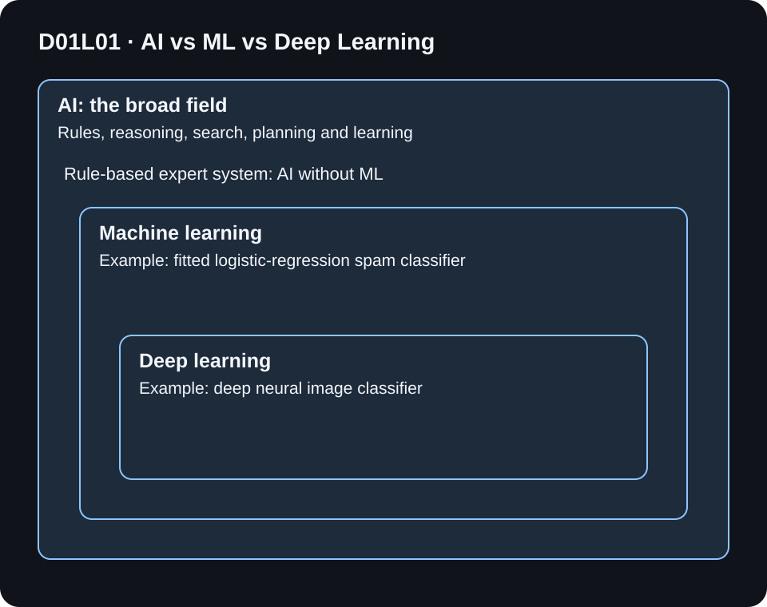
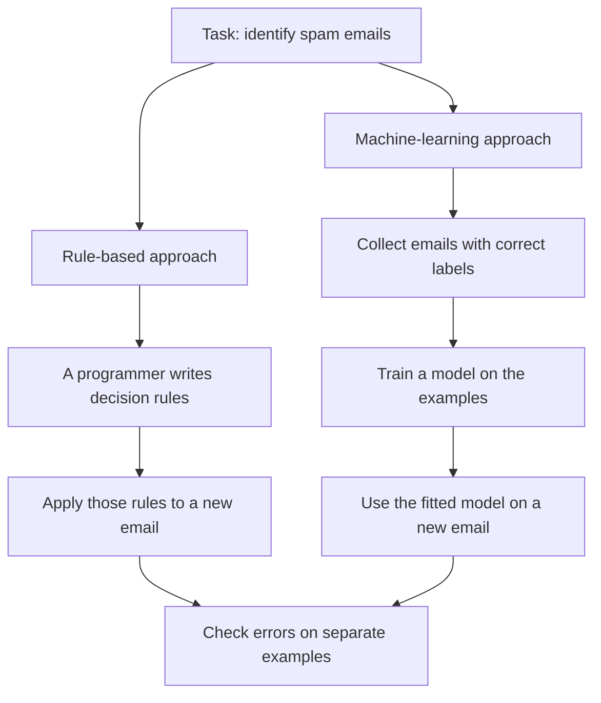
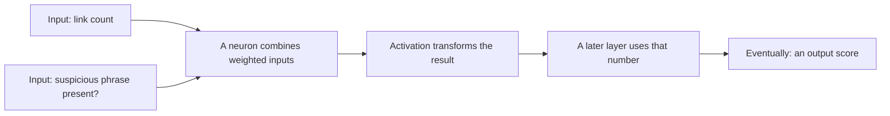
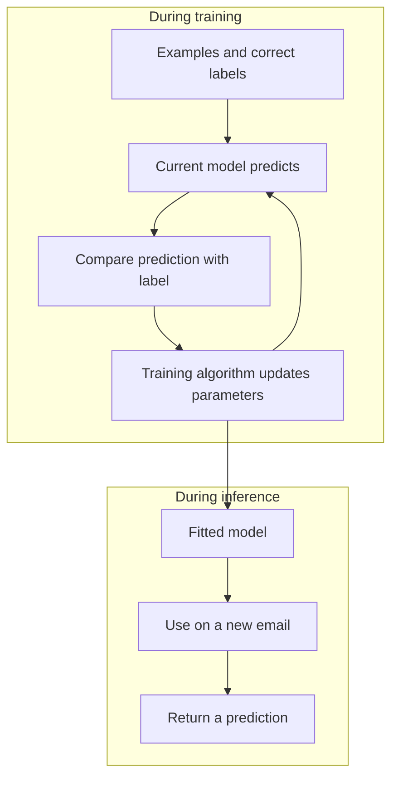

# Day 1, Class 1 - AI vs ML vs Deep Learning

**D01L01** · Becoming an AI Engineer · Beginner · No coding required · About 25-35 minutes

[Day 1 home](../README.md) | **Class 1 of 3** | [Next: Class 2](../02-generative-ai-vs-traditional-ai/README.md) | [Word dictionary](../GLOSSARY.md)

> **Start here:** AI, machine learning, and deep learning are related names, not three competing apps. We will build the picture one idea at a time. You do not need to memorize an equation.

## Learning map

[What you will learn](#what-you-will-learn) · [The email example](#beginner-explanation) · [Visual family map](#visual-explanation-guidance) · [What is a neural network?](#neural-network) · [Training vs using](#deeper-explanation) · [Try it](#practice-questions) · [Continue to Class 2](#continue-learning)

## What you will learn

By the end, you should be able to:

- Explain AI, ML, and deep learning in your own words.
- Describe what changes between a hand-written rule and a learned model.
- Explain a neural network, neuron, layer, and weight without assuming a background in AI.
- Tell training from inference and explain why a new email is an important test.

### Before you start: three everyday words

| Word | Plain meaning | Our email example |
| --- | --- | --- |
| **Input** | What you give a system | The email to examine |
| **Output** | What the system returns | A label: spam or normal |
| **Data** | Recorded information or examples | A collection of emails |

A **model** is a mathematical system that maps inputs to outputs. When we say a model "learns," we mean a training process changes its internal numerical settings. We are not saying it becomes conscious.

## Beginner explanation

### 1. Start with a problem you already understand

Your inbox receives these messages:

| Email | What a person would like the filter to do |
| --- | --- |
| "You won a free prize. Click this link." | Mark as spam |
| "Your meeting starts at 10." | Leave in the normal inbox |
| "Please review the invoice attached." | Usually leave in the normal inbox, after appropriate checks |

The task is to decide which messages are unwanted. There are different ways to build a system for that task. Its user interface alone does not tell us which method it uses.

### 2. One approach: a programmer writes rules

A simplified rule might be:

```text
IF the email contains "free prize"
THEN mark it as spam
OTHERWISE leave it alone
```

This is easy to inspect. It can also fail: "claim your reward" might bypass it, while a legitimate discussion about a free prize could be wrongly blocked. Adding rules for every possible wording becomes difficult.

A rule-based **expert system** combines explicit knowledge with reasoning rules. This is an example of AI that need not learn from data. Not every ordinary `if` statement deserves the label AI; the task and reasoning system matter.

### 3. Another approach: learn from examples

Instead of writing every rule, we provide examples with answers:

| Training example | Human-provided answer |
| --- | --- |
| "Claim your reward now" | spam |
| "Here is tomorrow's meeting agenda" | normal |
| "A prize is waiting; visit this link" | spam |
| "Can we move the meeting?" | normal |

The answer attached to an example is called its **label**. Fitting a model to input-label pairs is **supervised learning**: the training examples include a target answer.

An engineer chooses a method and a training objective. A training algorithm changes model settings so its outputs better match the examples. Afterward, we try it on a **new email**, whose answer was not used to fit the model.

This is **machine learning**, or **ML**. People still do substantial work: choose suitable data, correct poor labels, define success, and check mistakes. "Learns from data" does not mean "needs no programming or supervision."

### 4. Where does deep learning fit?

A neural network is one type of learned model. When it has multiple processing layers that learn representations, we are in **deep learning**, or **DL**.

A **representation** is how information is expressed for the next part of a system. An image starts as pixel values. A network can transform those numbers into other numbers that help distinguish objects. "Edges, then patterns, then objects" is a useful simplified illustration for some image models, not a promise about the exact job of every layer.

A spam classifier could use a simple ML method or a deep network. The task name does not decide the implementation.

### 5. Put the names together

**Artificial intelligence (AI)** is the broad field of systems for tasks such as planning, reasoning, perception, and language. ML is one approach within AI. Deep learning is a family of methods within ML.

A useful analogy is a set of toolboxes: the AI toolbox contains ML tools; the ML toolbox contains deep-learning tools. The nesting describes membership, not a ranking from "bad" to "good."

## Visual explanation guidance

### The family map



**Read it in three steps:**

1. Begin at the outside: AI includes several approaches to intelligent tasks.
2. Enter ML: this region contains methods fitted to data. A simple classifier such as logistic regression belongs here without being a deep network.
3. Enter deep learning: these models are also ML and AI. A deep image classifier therefore belongs to all three regions at once.

If a diagram does not load, the relationship is simply **deep learning is part of ML, and ML is part of AI**. Three separate circles would teach the wrong relationship.

### The same inbox, two construction methods



Both paths need checking. The difference is how the decision behavior is constructed. In the left path it is specified directly; in the right path it is fitted from examples.

<details>
<summary>Pause and predict: if the filter has a chat window, does that prove it uses deep learning?</summary>

No. A chat window is an interface. Behind it could be hand-written rules, a search system, a learned model, or a combination. Ask how the system actually works.

</details>

## Neural network

The standard term is **neural network**. "Neural networking" is sometimes used informally, but we are not talking about connecting computers over Wi-Fi.

Think of a small assembly line of numerical calculations. A unit receives numbers, combines them, and passes a result to the next stage. Connected units form a network.

| Part | What it means here | What it does not mean |
| --- | --- | --- |
| **Neuron / node** | One mathematical processing unit | A biological brain cell inside the computer |
| **Weight** | An adjustable multiplier on an input | A physical weight or proof that a feature causes an outcome |
| **Bias** | An adjustable offset added to a calculation | The same thing as social unfairness |
| **Activation function** | A transformation applied to the combined value | A switch that creates consciousness |
| **Layer** | A stage containing processing units | A separate app |
| **Hidden layer** | A stage between input and output | Secret knowledge inaccessible to engineers |



The drawing shows the role of a unit, not a complete trained spam filter. A real model can use different inputs and a more complex structure. The basic weighted-input, bias, and activation explanation follows [Google's neural-network introduction](https://developers.google.com/machine-learning/crash-course/neural-networks/nodes-hidden-layers).

<details>
<summary>Optional: calculate one neuron with tiny numbers</summary>

This is an invented arithmetic example, not trained model output.

Suppose we encode an email as:

- `x1 = 2`: it contains two links.
- `x2 = 1`: it contains a phrase our example marks as suspicious.
- `w1 = 0.4`, `w2 = 0.8`: two example weights.
- `b = -0.3`: an example bias.

Combine the inputs:

```text
z = x1 * w1 + x2 * w2 + b
  = 2 * 0.4 + 1 * 0.8 - 0.3
  = 1.3
```

Use **ReLU**, an activation that returns `max(0, z)`:

```text
output = max(0, 1.3) = 1.3
```

If `w1` were `0.1`, keeping everything else the same, `z` would become `0.7`. Changing a weight changes the calculation.

**Important:** `1.3` is a unit's output, not a 130% probability. A final classifier needs an appropriate output interpretation and decision rule. This calculation does not train a model or demonstrate spam-detection quality.

</details>

### Why use layers?

A later layer can combine the outputs of an earlier layer instead of working directly with the raw input. This lets a network build useful intermediate representations. Nonlinear activation functions matter: merely stacking linear calculations would still produce a linear transformation.

**Deep** describes layered computation. It does not automatically mean wiser, more reliable, or better for every task. The introductory relationship between AI, representation learning, and deep learning is discussed in the primary textbook [Deep Learning, Chapter 1](https://www.deeplearningbook.org/contents/intro.html).

## Deeper explanation

### Training is practice; inference is use

**Training** changes the model's parameters, such as weights and biases, using examples and a chosen objective. **Inference** means using the resulting model to produce an output.



The comparison produces a **loss**: a numerical training penalty. The exact objective depends on the method. The diagram describes a supervised-training loop, not every kind of ML.

Giving a chatbot information in a message usually changes the context of that request. It does not by itself prove that its learned parameters were updated. Keeping conversation history is also different from training weights.

### Learning the examples is not enough

A student might memorize practice answers but struggle on a fresh question. A model can similarly perform well on training data and poorly on new relevant data. This is a useful way to understand **overfitting**.

**Generalization** means useful performance beyond the examples used to fit the model. Keep a separate test set. If test answers accidentally influence training or repeated design choices, the reported result can become misleading; this is one form of **data leakage**.

## Worked example

You review five new emails that were not used for training:

| Email | Correct label | Model's prediction | Correct? |
| --- | --- | --- | --- |
| A | spam | spam | Yes |
| B | normal | normal | Yes |
| C | normal | spam | No |
| D | spam | spam | Yes |
| E | normal | normal | Yes |

```text
accuracy = correct predictions / total predictions
         = 4 / 5
         = 80%
```

Email C is a **false positive**: a normal email incorrectly flagged as spam. This can be costly if it hides an important message. A spam email missed by the filter would be a **false negative**.

Five emails are nowhere near enough to establish reliability. Ask whether the set is representative and whether particular users or message types suffer more mistakes. A single percentage is not the whole story.

### Classify the implementation, not the product name

| System description | AI? | ML? | Deep learning? |
| --- | --- | --- | --- |
| Expert system reasons using hand-authored facts and rules | Yes | No | No |
| Simple classifier fitted to labeled emails | Yes | Yes | Not necessarily |
| Deep neural image classifier | Yes | Yes | Yes |
| An app only described as "a chatbot" | Cannot tell | Cannot tell | Cannot tell |

No account, installation, API call, or training run is needed for this activity. The tables and arithmetic are worked teaching examples, not benchmark measurements.

## Common mistakes

| Common thought | Better explanation |
| --- | --- |
| "All automation is AI." | A routine rule is not automatically intelligent reasoning. Describe the task and mechanism. |
| "All AI learns from data." | Some AI uses explicit knowledge, rules, or search. |
| "All ML uses a neural network." | Many ML methods are not neural networks. |
| "A neural network is a human brain." | It is a mathematical model with a biologically inspired name. |
| "Deep learning is always the best choice." | Task, data, cost, speed, reliability, and interpretability matter. Start with a simple comparison approach. |
| "It got every training example right, so it works." | Check relevant examples kept out of training. |

## Quick recap

**AI is the field. ML is an approach that learns from data. Deep learning is ML using layered neural networks.** Training fits parameters; inference uses a model. Judge the system on new relevant examples, not only its training sheet.

## Practice questions

Try these before opening the answers. You can answer on paper.

1. Is every deep-learning model also an ML model? Is the reverse true?
2. What are the input, label, and predicted output in our spam example?
3. What does a neuron do? Name the role of a weight and a bias.
4. A model scores perfectly on training emails but poorly on fresh emails. Is "it has learned everything" a good conclusion?
5. A rule gets 8 of 10 separate test emails correct. Compute accuracy. Does this prove the rule is ready for all users?
6. You see a chatbot. What extra information would you need before calling it deep learning?

<details><summary>Answers and reasoning</summary>

1. Yes; no. Deep learning is a subset of ML.
2. Input: an email or its representation. Training label: the human-provided spam/normal answer. Predicted output: the model's proposed label or score, which may be wrong.
3. It combines weighted input numbers with a bias and applies an activation. A weight multiplies an input; a bias adds an offset.
4. No. Investigate overfitting, unrepresentative data, distribution differences, and evaluation mistakes. Test separately.
5. `8 / 10 = 80%`. No: the set is tiny, may omit important cases, and does not explain the cost of each type of mistake.
6. Its implementation: whether it uses a learned model, which model family, and whether that model is a deep neural network. The chat interface is insufficient evidence.

</details>

### Your understanding checklist

- [ ] I can explain the nesting AI > ML > deep learning.
- [ ] I can define a neural network, neuron, layer, weight, and bias.
- [ ] I can tell training from inference.
- [ ] I can explain why testing new emails matters.

If one item is unclear, revisit that section. You do not need to understand every training algorithm before moving on.

## Glossary

**Model:** input-to-output mathematical system. **Dataset:** collection of examples. **Feature:** input value or representation. **Label:** target answer attached to a training example. **Parameter:** adjustable model value. **Loss:** training penalty. **Baseline:** simple approach used for comparison. **Generalization:** performance beyond training examples.

Need a fuller definition? [Open the linked Day 1 dictionary](../GLOSSARY.md), including [neural network](../GLOSSARY.md#neural-network), [activation function](../GLOSSARY.md#activation-function), and [overfitting](../GLOSSARY.md#overfitting).

## References

These are explanations to explore after the lesson, not prerequisites. The examples and diagrams above are original teaching material.

- Goodfellow, Bengio, and Courville, [Deep Learning - Chapter 1](https://www.deeplearningbook.org/contents/intro.html), 2016. Introduction to the relationships among AI, ML, representations, and deep learning.
- Google, [Neural networks: nodes and hidden layers](https://developers.google.com/machine-learning/crash-course/neural-networks/nodes-hidden-layers). Explanation of units, layers, weighted inputs, biases, and activations.
- Google, [ML fundamentals glossary](https://developers.google.com/machine-learning/glossary/fundamentals). Further terminology and evaluation definitions.

Updated 2026-11-05. Introductory source sections checked; no trained-model or product-performance result is claimed.

## Continue learning

**You finished Day 1, Class 1.** You now know how the AI family fits together. Next, use the same email to compare choosing a label with creating a reply.

### [Continue to Day 1, Class 2 - Generative AI vs Traditional AI →](../02-generative-ai-vs-traditional-ai/README.md)

| Your next step | Link |
| --- | --- |
| Continue in order | **[Open Class 2 →](../02-generative-ai-vs-traditional-ai/README.md)** |
| Review vocabulary | [Day 1 dictionary](../GLOSSARY.md) |
| Choose another class | [Day 1 home](../README.md) |
| See the complete course plan | [90-lesson roadmap](../../../ROADMAP.md) |

If the guide helped, you can star the repository to find the series again. Access to the lessons is always free.
