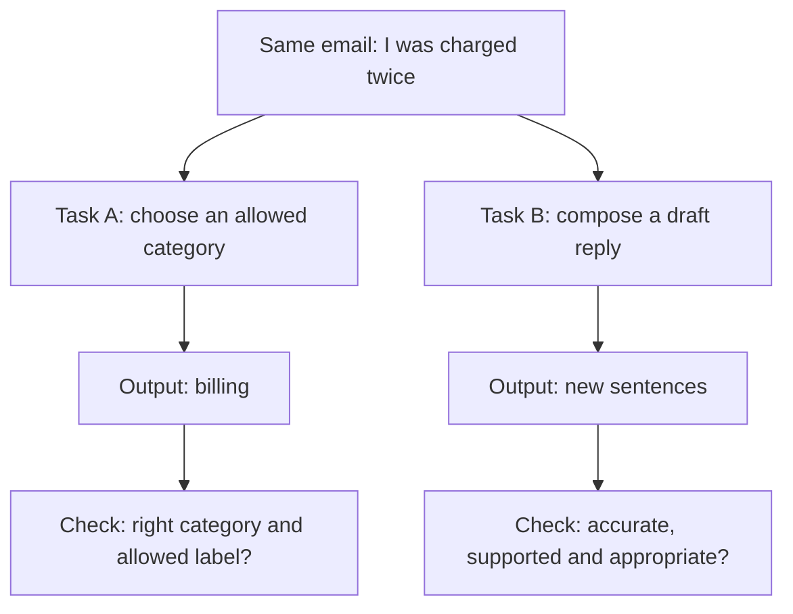
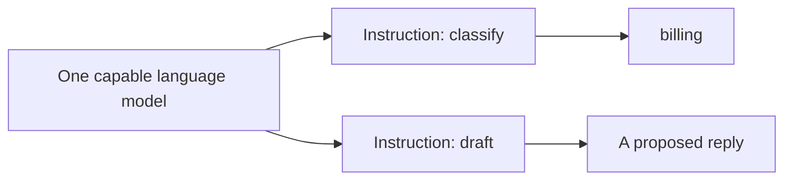
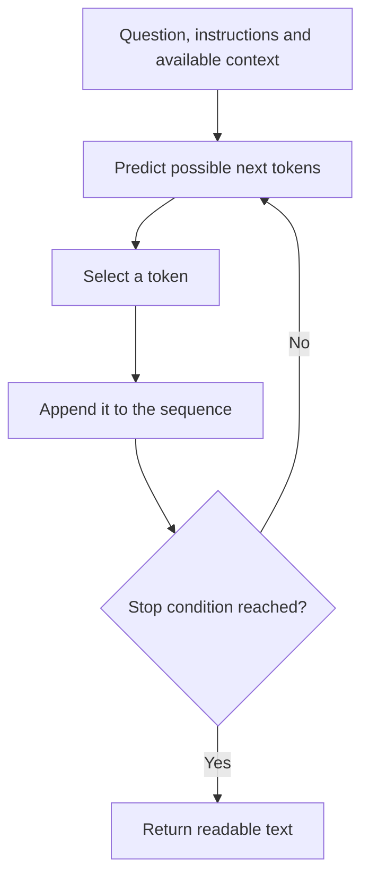

# Day 1, Class 2 - Generative AI vs Traditional AI

**D01L02** · Becoming an AI Engineer · Beginner · No coding required · About 25-35 minutes

[Previous: Class 1](../01-ai-vs-ml-vs-deep-learning/README.md) | [Day 1 home](../README.md) | **Class 2 of 3** | [Next: Class 3](../03-what-ai-engineers-actually-build/README.md) | [Dictionary](../GLOSSARY.md)

> **The question:** if the same email goes into two AI systems, why might one return `billing` while the other writes a whole reply?

## Learning map

[What you will learn](#what-you-will-learn) · [One email, two jobs](#beginner-explanation) · [Visual walkthrough](#visual-explanation-guidance) · [What is a token?](#tokens-and-next-token-prediction) · [How to check the outputs](#deeper-explanation) · [Practice](#practice-questions) · [Continue to Class 3](#continue-learning)

## What you will learn

- Tell a classification task from a content-generation task by looking at the requested output.
- Define prompt, language model, token, tokenizer, context, and hallucination in plain English.
- Follow a small example of text growing one piece at a time.
- Explain why the same model can perform different tasks.
- Design different checks for a category and for a written reply.

### Previously learned

In [Class 1](../01-ai-vs-ml-vs-deep-learning/README.md), we learned that **AI** is the broad field, **ML** learns from examples, and **deep learning** uses layered neural networks within ML. A **model** maps inputs to outputs. **Inference** means using it; **training** means fitting its parameters.

You can still follow this class if you arrived here first. The central distinction is the job we ask the system to do, not the name on the model's website.

## Beginner explanation

### 1. Keep the input exactly the same

Imagine this incoming support email:

```text
I was charged twice for the same order. Can you help?
```

Our support team might need two things:

1. Send the email to the right queue.
2. Prepare a useful reply for a person to review.

These are related tasks, but their outputs are different.

### 2. Job A: choose a category

For routing, the allowed categories might be:

```text
billing | delivery | account | other
```

The system reads the email and returns:

```text
billing
```

This is **classification**: selecting a category. We do not need an essay; we need a correct label from the allowed list. Predictive tasks can also return numbers or rankings, such as a delivery-time estimate or an ordered list of relevant documents.

In casual comparisons, people often call such systems "traditional AI." That phrase is a broad contrast label, not the name of one algorithm. These systems can use rules, simple learned models, or deep learning. Traditional AI is not limited to rules, and AI also includes tasks such as planning and search.

### 3. Job B: create a draft

For a reply, a proposed output might be:

```text
I'm sorry about the duplicate charge. Our support team can review
both payment records. Please use the secure support form to provide
the details needed for that review.
```

This is an invented teaching draft, not an actual customer message or a verified company policy.

Here, the system is composing content instead of returning only a label. This is a **generative task**. Generative AI can also produce images, audio, or code; this class focuses on text so we can inspect the example closely.

Notice what the draft does not establish: it does not prove a duplicate charge occurred, approve a refund, or show that the reply follows a real company's process. Those are separate questions to check.

### 4. A simple way to remember the distinction

| Ask for... | Example output | Task |
| --- | --- | --- |
| A category | `billing` | Classification |
| A number | `3 days` | A numerical prediction, if that is the defined target |
| An ordered list | `document C, document A, document B` | Ranking |
| New content | A paragraph replying to the customer | Generation |

**Look at the task's output contract**: the agreed shape and meaning of the answer. Do not decide only from whether the interface looks like chat.

## Visual explanation guidance

### One email, two requested outputs



Read the diagram from the shared email downward. The branches represent two possible tasks. They do not say that one model must label an email before it can generate text.

### Same capable model, different instruction

A **prompt** is the input used to guide a model's response. It can contain an instruction, a question, examples, and supporting context.

| Prompt to a capable language model | Intended output |
| --- | --- |
| "Choose one of billing, delivery, account, or other. Return only the label." | A category |
| "Using the approved support policy below, draft a short reply for review." | New text |



The drawing shows task choice, not an assertion that every language model performs both jobs well. Evaluate the actual model and instructions. A model from a generative family can be used for classification; the categories overlap.


The static illustration provides another view. A good caption for the whole lesson is: **same input, different requested output, different checks**.

## Tokens and next-token prediction

### First, what is a language model?

A **language model** models language sequences. In our text-generation example, it uses the available text to predict possible next pieces. Many modern language models use deep neural networks: layered mathematical units introduced in Class 1. **LLM** means large language model; "large" does not give you a guarantee of correctness.

A **token** is a text-encoding unit. Depending on the tokenizer, it may represent a word, part of a word, punctuation, or another unit. A **tokenizer** converts text to token IDs and can convert those IDs back to text.

```text
Text a person reads
       |
       v
Tokenizer: text -> token IDs
       |
       v
Model works with encoded input
       |
       v
Selected output token IDs -> readable text
```

Do not memorize a fixed rule such as "one token equals one word." Exact splits depend on the tokenizer and its vocabulary. See the official [Hugging Face explanation of tokenization algorithms](https://huggingface.co/docs/transformers/tokenizer_summary) for real algorithm examples.

### Watch a reply grow

For teaching, imagine a tokenizer whose pieces include `Please`, ` review`, ` the`, ` charge`, and `.`. The spaces here are part of our illustrative notation. This is not output from a particular real tokenizer.

| Step | Text available before this step | Chosen next piece | Text after the step |
| --- | --- | --- | --- |
| 1 | Your question and instructions | `Please` | `Please` |
| 2 | Same input plus `Please` | ` review` | `Please review` |
| 3 | Same input plus `Please review` | ` the` | `Please review the` |
| 4 | Same input plus `Please review the` | ` charge` | `Please review the charge` |
| 5 | Same input plus the sentence so far | `.` | `Please review the charge.` |



**Context** means the information available for that request, including earlier generated text. A stop condition might be an end marker or a configured output limit. The precise implementation varies.

This repeated process is called **autoregressive generation**: later pieces depend on the preceding sequence. It describes a common text-generation approach, not every generative image, audio, or text model. The original [GPT-3 research paper](https://arxiv.org/abs/2005.14165) is one primary example of an autoregressive language model used across multiple tasks.

<details>
<summary>Optional: does the model always choose the most likely token?</summary>

Not necessarily. **Decoding** is the procedure used to choose output tokens. One method picks the highest-scoring token; another samples from a set of possibilities. Controls can affect variation, but changing a sampling setting is not a truth-verification method.

Imagine these made-up next-piece probabilities:

| Candidate | Illustrative probability |
| --- | --- |
| ` review` | 0.55 |
| ` check` | 0.30 |
| ` confirm` | 0.15 |

The numbers sum to 1. A highest-probability choice would pick ` review`; sampling can select another piece. These are invented values to explain choice, not measured model probabilities.

Whichever token is chosen, a plausible continuation is not proof of a real-world fact.

</details>

## Deeper explanation

### Prediction and generation are not opposites

At the task level, we distinguish a category from newly composed text. Inside an autoregressive generator, predicting the next token repeatedly is how the content is produced. So "generative AI does not predict anything" is incorrect.

A useful pair of questions is:

1. **What are we asking for?** A label, number, ranking, or new content?
2. **How is the model doing it?** Rules, a learned classifier, token generation, or another method?

Task and mechanism are different layers of description. Keeping them separate avoids a lot of confusion.

### Why a fluent reply can still be wrong

Suppose a draft says:

```text
Your refund will arrive tomorrow.
```

It is short and grammatical. But our example has supplied no approved refund date. The sentence therefore fails the support test even though it reads smoothly.

A false or unsupported generated claim is often called a **hallucination** or **confabulation**. This terminology describes an output problem; it does not imply that the model has human experiences.

Providing relevant documents can help a model use evidence. It still needs checks: the document might be irrelevant or outdated, and the model might misread it. We will build that surrounding workflow in [Class 3](../03-what-ai-engineers-actually-build/README.md).

### Why the right test changes with the task

| Task | A useful question to test | A failure to notice |
| --- | --- | --- |
| Classification | Did it choose the correct allowed category? | An invented label such as `urgent refund department` |
| Numerical prediction | How close was the estimate to the observed value? | A number without the required units |
| Ranking | Were useful items placed near the top? | A permitted-looking but irrelevant document |
| Drafting | Are the claims supported, relevant, and safe to send? | A polished sentence promising an unauthorized action |

For a fixed category, a small classifier or ordinary code may be enough. For a draft, you may need generated language, evidence, and review. Complexity should earn its place through measured usefulness.

## Worked example

Assume the following **invented policy for this exercise**:

```text
Duplicate-charge reports go to billing support.
Support reviews the payment records.
This policy does not promise a refund date or approve a refund.
```

Review these proposed outputs:

| Proposed output | Pass or fail? | Reason |
| --- | --- | --- |
| Routing label: `billing` | Pass for this example | Correct category from the allowed set |
| Routing label: `refund team` | Fail | Not an allowed label |
| Draft: "Billing support can review the payment records." | Supported by the example policy | Appropriate scope; not yet a real customer-send approval |
| Draft: "Your refund is approved and arrives tomorrow." | Fail | Invents both approval and timing |

### A tiny evaluation calculation

A routing model gets four of five separate example emails right:

```text
routing accuracy = 4 / 5 = 80%
```

That tells you about those five labels. It does not tell you whether generated drafts are truthful. You need a separate draft-review checklist:

- [ ] Did it address the actual question?
- [ ] Is every policy claim supported by the supplied approved evidence?
- [ ] Did it invent a date, action, amount, or citation?
- [ ] Does it avoid unnecessary private information?
- [ ] Does it ask for review or escalation when the evidence is insufficient?

These are worked examples, not tests of a deployed model. No API account or model call is required to complete the activity.

## Common mistakes

| Mistake | Correction |
| --- | --- |
| "Traditional AI means hand-written rules only." | Predictive systems can use learned models, including deep networks. The phrase is loose. |
| "A generative model cannot classify." | A capable language model can be instructed to choose a label. Test that behavior. |
| "A token is always a complete word." | Tokenization can use word pieces and other units. |
| "Generation means copying one stored answer." | Generating a continuation is different from looking up a fixed reply, although systems can combine retrieval and generation and may reproduce memorized text. |
| "A different wording means the answer is more correct." | Variation and truth are different properties. |
| "If it sounds confident, send it." | Check evidence and action boundaries before use. |

## Quick recap

**Predictive tasks often ask for a label, number, or ranking. Generative tasks ask for content.** A text generator can build that content by repeatedly predicting tokens. The same model can support different tasks, so define the expected output and test the behavior you need.

## Practice questions

1. The same model returns `billing` for one prompt and a paragraph for another. Did it necessarily become a different model?
2. Is estimating tomorrow's delivery count the same output task as composing a delivery email?
3. Explain token and tokenizer to a friend without using either word in your definition.
4. Why is the claim "generation is the opposite of prediction" misleading?
5. An answer follows the required format but invents a refund date. Did it pass?
6. Design a workflow for the same support email that needs both routing and a reply. Where do checks belong?

<details><summary>Answers and reasoning</summary>

1. No. Different instructions can use the same model for different tasks. Actual suitability must be evaluated.
2. No. One asks for a numerical prediction; the other asks for composed content. Their checks differ.
3. One possible answer: a model represents text as encoded pieces; a converter splits text into those pieces and maps them to numerical IDs.
4. Task categories describe the requested output; next-token prediction can be the mechanism used to generate text.
5. No. Format correctness does not establish factual or policy correctness.
6. Route to an allowed category, obtain permitted policy/context, draft, check claims and permissions, and review before sending. Escalate when evidence or authority is missing. Evaluate routing and drafting separately.

</details>

### Your understanding checklist

- [ ] I can show two different requested outputs for one email.
- [ ] I know that a token is not necessarily a word.
- [ ] I can trace one next-token generation loop.
- [ ] I can explain why a fluent draft still needs evidence.

## Glossary

**Classification:** choose a category. **Generative task:** compose content. **Prompt:** model-guiding input. **Context:** information available for the current request. **Token:** encoded text unit. **Tokenizer:** text-to-token-ID converter. **Decoding:** selecting output tokens. **Hallucination:** false or unsupported generated content. **Output contract:** required form and meaning of an answer.

[Open the Day 1 dictionary](../GLOSSARY.md) for linked definitions, including [language model](../GLOSSARY.md#language-model), [token](../GLOSSARY.md#token), and [grounding](../GLOSSARY.md#grounding).

## References

- Hugging Face, [Tokenization algorithms](https://huggingface.co/docs/transformers/tokenizer_summary). Official explanation of tokenization and why exact splits depend on the algorithm and vocabulary.
- Brown et al., [Language Models are Few-Shot Learners](https://arxiv.org/abs/2005.14165), 2020, arXiv v4. Primary research example of an autoregressive model used for multiple tasks; this guide does not reproduce its benchmark results.
- Lewis et al., [Retrieval-Augmented Generation for Knowledge-Intensive NLP Tasks](https://arxiv.org/abs/2005.11401), 2020 paper, arXiv v4 revised 2021. Primary research on combining retrieval with generation. Supplying evidence does not by itself guarantee faithful output.

Updated 2026-11-05. Source introductions/abstracts checked. All policies, proposed responses, token pieces, and probabilities in the worked activity are illustrative, not live system outputs.

## Continue learning

**You finished Day 1, Class 2.** Next, turn these tasks into a useful application: who checks access, finds evidence, tests the behavior, and handles failures?

### [Continue to Day 1, Class 3 - What Does an AI Engineer Actually Build? →](../03-what-ai-engineers-actually-build/README.md)

| Back | Continue | Vocabulary |
| --- | --- | --- |
| [Class 1 - AI, ML and deep learning](../01-ai-vs-ml-vs-deep-learning/README.md) | **[Open Class 3 →](../03-what-ai-engineers-actually-build/README.md)** | [Day 1 dictionary](../GLOSSARY.md) |

[Day 1 home](../README.md) · [All planned lessons](../../../ROADMAP.md)

If the guide helped, you can star the repository to follow the series. Reading the lessons never depends on a star.
