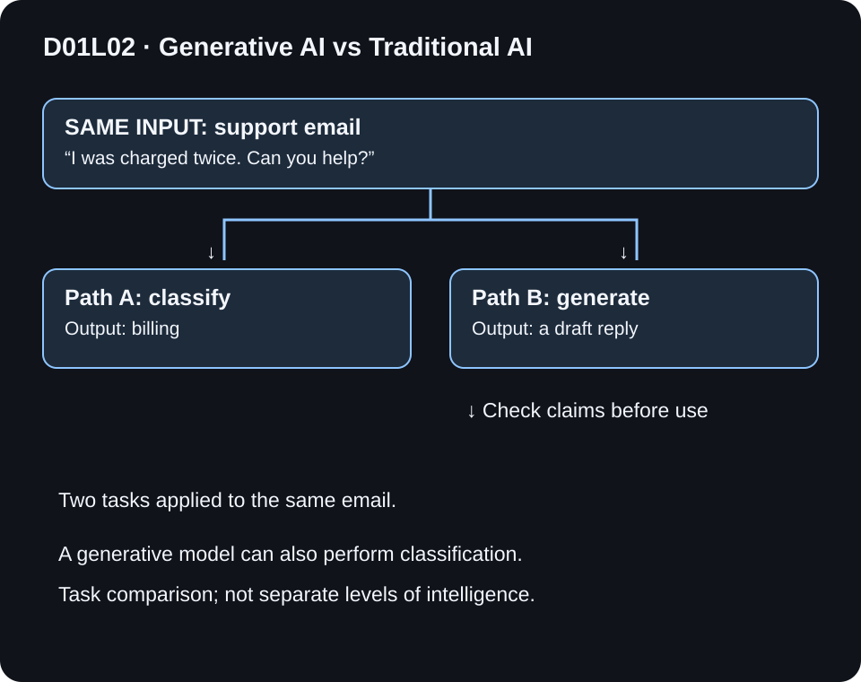

# D01L02 — Generative AI vs Traditional AI

## Start with one concrete example

Use one input: “I was charged twice. Can you help?” A predictive task can return the category billing so the email reaches the right queue. A generative task can draft new text, such as a proposed reply asking to review the charge. The same capable language model can perform either task when instructed appropriately; these are task distinctions, not two completely separate kinds of software. A generated reply is a draft to verify against evidence and policy, not proof that a refund is authorized.

This is the worked example used in the revised editorial Reel. The sections below explain the details and limitations.

> Prepared locally for editorial review; not yet published.

**Day:** 01 · **Lesson:** 2/3 · **Level:** beginner · **Study time:** approximately 15–25 minutes
**Prepared:** 2026-11-05 · @kiranbuildswithai

**Previously learned:** D01L01 — AI is the broad field; ML learns from data; DL is multilayer neural-network learning within ML.

## What you will learn

- Distinguish predictive tasks from content-generation tasks using inputs and outputs.
- Explain why next-token prediction can produce a long response.
- Identify overlap between tasks and choose an evaluation method for each.

## Before you start

In **D01L01: AI vs ML vs Deep Learning**, we learned that DL sits within ML and AI. A **model** maps inputs to outputs; **inference** applies that model. You can follow this lesson with those two definitions alone.

## Beginner explanation

Imagine one incoming email: “I was charged twice. Can you help?”

A predictive system might assign a category, such as **billing**, estimate urgency, or rank which team should handle it. A generative system might compose a response: “Thanks for flagging this. Please use the secure support form so our team can review the duplicate charge.” That sentence is an illustrative human-written draft, not output from a model run.

Here, **traditional AI** is shorthand for familiar non-generative tasks such as classification, regression, and ranking. It is not a formal, exhaustive technical category. Older AI also includes rules, search, and planning. Generative modeling has a long history; it did not begin with chat apps.

**Generative AI** models create content such as text, images, audio, or code using patterns learned from data. Creating content does not guarantee originality, accuracy, or ownership rights. A generator can reproduce familiar wording or make unsupported claims.

## Visual explanation guidance

Use the *same email* in both paths so the output difference is clear. The left path ends with a category. The right path ends with several words, then a review gate. This is a task comparison, not a claim that the paths always use different model families.

## Deeper explanation

### Predictive tasks

- **Classification:** choose a class, such as billing versus shipping.
- **Regression:** estimate a quantity, such as delivery duration.
- **Ranking:** order candidates, such as search results.

A classifier may estimate `P(label | input)` and choose a label or abstain. A fraud score is an estimate under a particular model, not proof that someone committed fraud. A threshold is a product decision that trades false positives against false negatives.

### Generation uses prediction too

An autoregressive text model constructs an output token by token. A token is a unit of text that can be a word, a piece of a word, punctuation, or another encoded unit. Given a prompt `x` and output tokens `y1 ... yT`, its sequence probability factors as:

$$P(y_1,\ldots,y_T \mid x)=\prod_{t=1}^{T} P(y_t \mid x,y_1,\ldots,y_{t-1}).$$

Read this as: predict the next token using the prompt and tokens already produced; repeat until stopping. During decoding, the system may choose a high-scoring token or sample from a distribution. Changing the prompt or sampling settings can change the response. Variation is not guaranteed on every run, and low randomness does not guarantee truth.

This is the mechanism for autoregressive language generation, not a universal description of all generative AI. Other methods, such as diffusion, generate differently. We cover those later.

### The categories overlap

A generative language model can output only “billing” when asked to classify an email. That is a classification *task* performed with a generative model. A predictive model and a generator can also work together. Do not draw generative AI as a sibling outside AI, or as a strict new level beyond deep learning. D01L01 described method families; this lesson compares what a task asks a system to output.

## Worked examples

| Input and task | Output contract | Useful evaluation |
| --- | --- | --- |
| Email → route to a department | One allowed label or abstain | Per-class precision/recall, confusion matrix |
| Historical sales → forecast demand | A number, often with uncertainty | Error on held-out time periods |
| Search query → order documents | Ranked document IDs | Relevance at the top of results |
| Email + approved policy → draft a reply | Text grounded in that policy | Factual support, completeness, policy compliance, human usefulness |

### A small classification calculation

Suppose an illustrative test has 10 billing emails. The classifier finds 8 and misses 2; it also wrongly calls 2 other emails billing. Billing precision is `8 / (8 + 2) = 80%`; billing recall is `8 / (8 + 2) = 80%`. The denominators mean different things even when the numbers coincide. These are hand-worked values, not a benchmark result.

### A draft-review activity

Approved policy says: “Duplicate charges are reviewed by support. Do not promise a refund before review.”

Draft A: “Your refund is approved and will arrive tomorrow.”

Draft B: “Our support team can review the duplicate charge. Please use the secure support form.”

A fails: it invents approval and timing. B is supported by the supplied policy and avoids collecting payment details in chat, though real deployment still needs review for tone and the actual support process. A grammatically fluent draft can be less useful than a cautious one.

**Why a worked activity instead of a model call?** The objective is task design and evaluation. No external model, account, payment, or API is needed. No generated response or benchmark is claimed.

## Common mistakes and limitations

- **“Traditional AI only uses rules.”** Many predictive systems use learned models, including deep networks.
- **“Generative AI cannot classify.”** The same language model can be prompted for labels or prose; test each task separately.
- **“Generation is the opposite of prediction.”** Output-level categories and internal modeling mechanisms are different viewpoints.
- **“The answer sounds confident, so it is correct.”** Check facts and sources. Retrieval can help supply evidence but cannot guarantee a faithful answer.
- **“Use generation for every task.”** A small classifier or ordinary code may be simpler and cheaper for a fixed output contract. Measure before choosing.
- **“Private emails are harmless prompt material.”** Minimize personal data, check permissions, and use a suitable data-handling process.

## Quick recap

Predictive tasks usually ask for labels, numbers, or rankings. Generative tasks ask for content. Autoregressive text generation repeatedly predicts tokens. Task categories overlap; evaluate the behavior you actually need.

## Practice questions

1. Is predicting next month’s revenue a generative task in this lesson’s comparison?
2. A language model returns only “billing”. What is the task, and what is the model family?
3. Why is “grammar is correct” an insufficient test for a support reply?
4. Design a two-step system for an email requiring both routing and a reply. Where should human review happen?

Answers and reasoning

1. No; it is regression/forecasting with a numerical output.
2. Classification task, implemented with a generative language model.
3. A reply can be grammatical while inventing policy, dates, or actions. Check against approved evidence and the task requirements.
4. Classify or route, then draft using approved policy and permitted context. Review before sending; abstain or escalate when evidence or authorization is missing. Measure both routing and draft quality.

## Glossary

- **Token:** an encoded text unit, not necessarily a whole word.
- **Autoregressive:** predicts the next element using earlier elements.
- **Decoding:** the procedure for choosing output tokens.
- **Precision:** correct positive predictions divided by all positive predictions.
- **Recall:** found positives divided by all actual positives.
- **Confabulation/hallucination:** generated content presented plausibly despite being false or unsupported.

## References

- Brown et al., [Language Models are Few-Shot Learners](https://arxiv.org/abs/2005.14165v4), v4 (2020). Primary research abstract consulted 2026-11-05; identifies GPT-3 as autoregressive and studies multiple tasks through text interaction. No benchmark claims from this paper are made here.
- Lewis et al., [Retrieval-Augmented Generation for Knowledge-Intensive NLP Tasks](https://arxiv.org/abs/2005.11401v4), v4 (2021; NeurIPS 2020). Primary abstract consulted 2026-11-05; combines retrieval and generation. Its results do not establish that retrieval eliminates errors.
- NIST, [Generative AI Profile, AI 600-1](https://www.nist.gov/publications/artificial-intelligence-risk-management-framework-generative-artificial-intelligence), published 2024-07-26, landing page consulted 2026-11-05. Further reading on lifecycle risk; this consultation does not claim a full profile audit.

## Continue learning

[Course roadmap](../../../ROADMAP.md). Next: D01L03 — What AI Engineers Actually Build. See the roadmap for release availability; no future live guide is implied.
