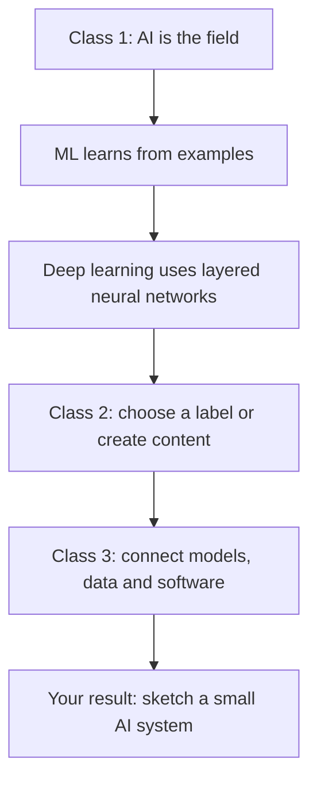

# Day 1 - Understand AI before you build with it

**Becoming an AI Engineer** · Three connected beginner classes · No coding required

You do not need to know what a model, token, or neural network is yet. These classes introduce the terms through an email example and then build toward a simple AI application.

## Choose your class

| Class | Start here | The question you will answer |
| --- | --- | --- |
| **1** | **[AI vs ML vs Deep Learning](01-ai-vs-ml-vs-deep-learning/README.md)** | How do these three names fit together? |
| **2** | **[Generative AI vs Traditional AI](02-generative-ai-vs-traditional-ai/README.md)** | What changes when software writes a reply instead of choosing a label? |
| **3** | **[What Does an AI Engineer Actually Build?](03-what-ai-engineers-actually-build/README.md)** | What must surround a model to make a useful application? |

**New here? [Start Day 1, Class 1 →](01-ai-vs-ml-vs-deep-learning/README.md)**

## Your route through the day

Read this as a learning sequence, not a claim that every AI application needs deep learning or generation.

## How to use these guides

1. Read the plain-language explanation before the optional technical detail.
2. Follow each diagram using its numbered explanation. The prose remains useful if your Markdown viewer does not render diagrams.
3. Try a question before opening **Answers and reasoning**.
4. Use the **Continue to Class ...** link at the bottom. It opens the next actual Markdown file in this repository, including on GitHub.

The diagrams use GitHub's Mermaid support. Expandable answers use standard Markdown/HTML details blocks. These pages do not require a separate website, JavaScript, an account with an AI provider, or paid tools. Checklist ticks are personal study prompts; GitHub may require edit permissions to persist a tick.

### A word stopped you?

Open the **[Day 1 plain-English glossary](GLOSSARY.md)**, or use the short definitions beside the examples. You can return to the class using the links in the glossary.

## Before you leave Day 1

- [ ] I can explain why deep learning is also machine learning and AI.
- [ ] I can distinguish training a model from using it.
- [ ] I can explain a neural network without saying it is a human brain.
- [ ] I can show a label and a generated reply for the same email.
- [ ] I can sketch the checks around a model in a useful application.

**[Start Class 1 →](01-ai-vs-ml-vs-deep-learning/README.md)** · [All 90 planned lessons](../../ROADMAP.md)

These are complete local learning guides. Release availability is tracked separately in the roadmap; following a local lesson link does not imply that the course has been published.
